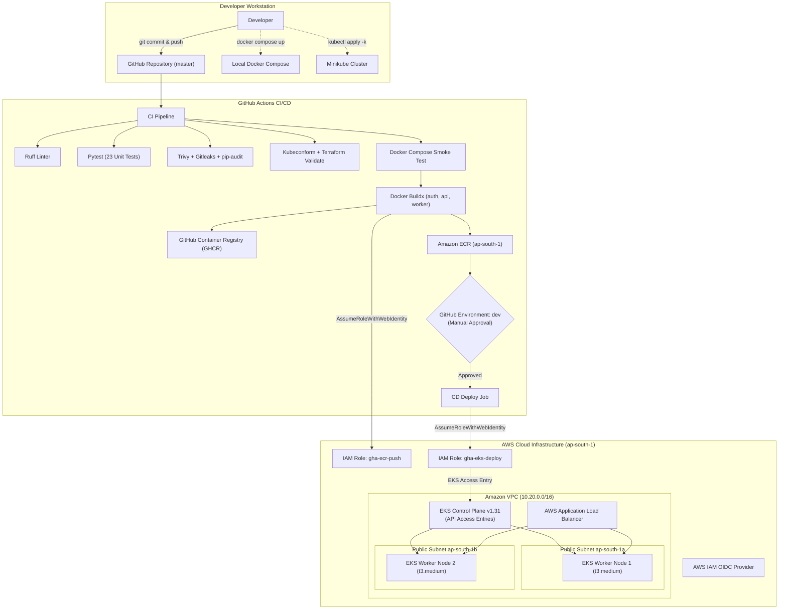
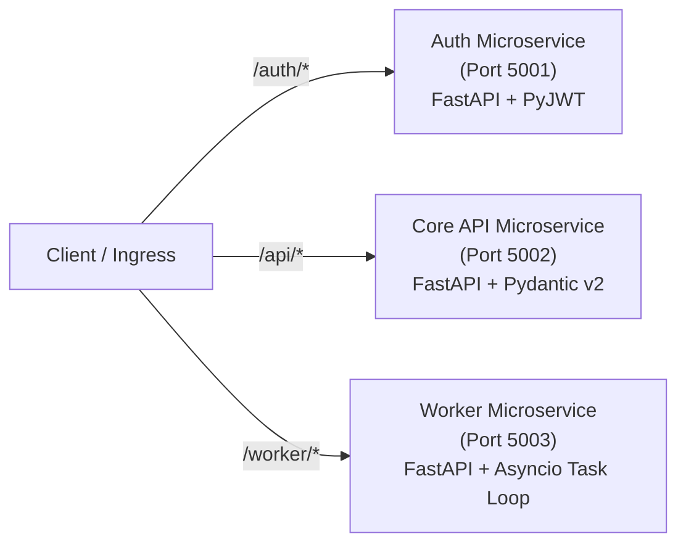
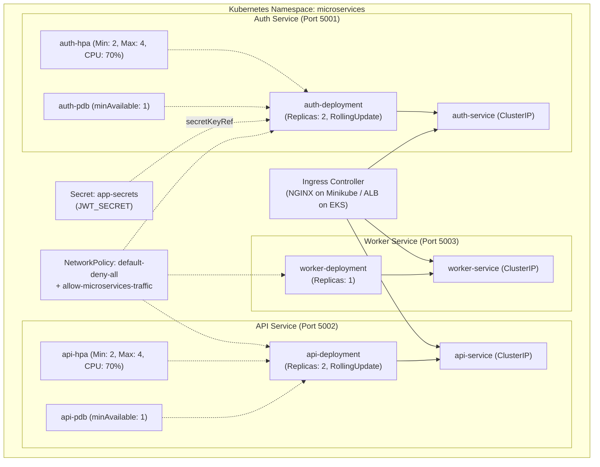

# System Architecture & Technical Specification

This document details the architectural design of the `microservice-cicd-kubernetes` platform across both **Local Development** and **AWS Cloud Production** deployment modes.

---

## 1. High-Level Architecture Overview



---

## 2. Microservices Architecture

The system is decomposed into three specialized, loosely coupled services:



### 1. Auth Service (`auth/`, Port 5001)
- **Role:** Handles user authentication, credential validation, cryptographic JWT token generation (HS256), and signature verification.
- **Key Endpoints:**
  - `GET /health`: Liveness probe with service metadata and UTC timestamp.
  - `GET /`: Discovery endpoint returning supported operations.
  - `POST /login`: Validates credentials against credential store and issues signed JWT bearer tokens.
  - `POST /verify`: Decodes and validates JWT tokens, returning claims and expiration status.
- **Security:** Decoupled `JWT_SECRET` injected via Kubernetes Secret `app-secrets`.

### 2. API Service (`api/`, Port 5002)
- **Role:** Core business domain service exposing data records, category filtering, item creation, and statistical aggregations.
- **Key Endpoints:**
  - `GET /health`: Readiness and liveness probe with uptime metrics.
  - `GET /api/data` & `GET /data`: Fetches datasets with optional category filter and pagination limit.
  - `GET /api/data/{id}` & `GET /data/{id}`: Retrieves single record or returns HTTP 404.
  - `POST /api/data` & `POST /data`: Creates and stores new records (HTTP 201 Created).
  - `GET /api/stats` & `GET /stats`: Statistical distribution across item categories.
- **Dual-Path Routing:** Binds both `/api/data` and `/data` to guarantee seamless compatibility with NGINX regex path rewrites or direct ALB path forwarding.

### 3. Worker Service (`worker/`, Port 5003)
- **Role:** Background task processor and queue simulation service.
- **Key Endpoints:**
  - `GET /health`: Probe returning cumulative processed jobs and uptime.
  - `GET /status`: Telemetry dashboard showing background task state, loop interval, and recent task history.
  - `POST /jobs`: Asynchronously enqueues on-demand maintenance tasks.
- **Async Runtime:** Employs FastAPI lifespan handlers managing a persistent `asyncio.Task` background processing loop.

---

## 3. Network Topology & Traffic Routing

### AWS Network Architecture
- **VPC CIDR:** `10.20.0.0/16`
- **Subnet Layout:**
  - `10.20.1.0/24`: Public Subnet in `ap-south-1a` (tagged `kubernetes.io/role/elb = 1`)
  - `10.20.2.0/24`: Public Subnet in `ap-south-1b` (tagged `kubernetes.io/role/elb = 1`)
- **Cost-Optimized Demo Mode:**
  - Worker nodes are placed in public subnets with security group isolation (no open ingress except via ALB or restricted management CIDRs).
  - **Zero NAT Gateway Cost:** Eliminates the ~$32.40/month baseline NAT charge while maintaining multi-AZ EKS resilience.
- **Production Mode (Toggleable via `enable_nat = true`):**
  - Worker nodes placed in private subnets (`10.20.10.0/24`, `10.20.20.0/24`).
  - Outbound internet access mediated through an Elastic IP and managed NAT Gateway.

### Kubernetes Ingress Path Mapping

```text
Incoming Traffic (HTTP Port 80)
           │
           ├─► /auth(/.*)   ──► auth-service:5001   (Auth & JWT)
           ├─► /api(/.*)    ──► api-service:5002    (Business Data)
           └─► /worker(/.*) ──► worker-service:5003 (Worker & Telemetry)
```

---

## 4. Kubernetes In-Cluster Architecture (`microservices` Namespace)



---

## 5. Security & Isolation Boundaries

1. **Identity & Credentials:**
   - No long-lived AWS IAM user access keys in repository secrets.
   - Authentication mediated via GitHub Actions OpenID Connect (OIDC) identity federation (`token.actions.githubusercontent.com`).
2. **Access Scoping:**
   - ECR Push Role scoped strictly to branch `master`.
   - EKS Deploy Role scoped to GitHub Environment `dev`.
   - EKS API Access Entries grant deployer role permissions strictly inside namespace `microservices`.
3. **Pod Hardening:**
   - Non-root user execution (`UID 10001`, `runAsNonRoot: true`).
   - Root filesystem mounted read-only (`readOnlyRootFilesystem: true`).
   - Linux capabilities dropped (`capabilities: drop: ["ALL"]`).
   - Privilege escalation blocked (`allowPrivilegeEscalation: false`).
   - Temporary write buffer confined to an `emptyDir` mounted at `/tmp`.

