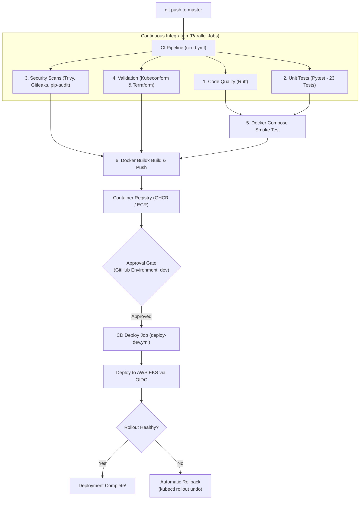

# The Ultimate Learning Guide: Microservices, Kubernetes, CI/CD, & Cloud on AWS

Welcome! If you are learning DevOps, Cloud Architecture, or Kubernetes, this guide is designed to take you from **ground zero** to understanding **every moving part** of this production-grade project.

---

## Table of Contents
1. [The Big Picture: What Are We Building & Why?](#1-the-big-picture-what-are-we-building--why)
2. [Level 1: The Application Layer (Python & FastAPI Microservices)](#2-level-1-the-application-layer-python--fastapi-microservices)
3. [Level 2: The Packaging Layer (Docker & Containerization)](#3-level-2-the-packaging-layer-docker--containerization)
4. [Level 3: The Orchestration Layer (Kubernetes & Kustomize)](#4-level-3-the-orchestration-layer-kubernetes--kustomize)
5. [Level 4: The Automation & Security Layer (GitHub Actions CI/CD & DevSecOps)](#5-level-4-the-automation--security-layer-github-actions-cicd--devsecops)
6. [Level 5: The Cloud Infrastructure Layer (Terraform & AWS EKS)](#6-level-5-the-cloud-infrastructure-layer-terraform--aws-eks)
7. [The Full Journey: What Happens When You Change One Line of Code?](#7-the-full-journey-what-happens-when-you-change-one-line-of-code)
8. [Hands-On Command Cheat Sheet](#8-hands-on-command-cheat-sheet)

---

## 1. The Big Picture: What Are We Building & Why?

### The Traditional Problem (The "Monolith")
In older software architectures, the entire application—login, business logic, background tasks, database connections—lived in a single, massive codebase. If the login system crashed, the whole website went down. If the background worker consumed 100% CPU, customer API requests timed out.

### The Modern Solution: Microservices
Instead of one big program, we split our system into **three independent, small programs (microservices)** that communicate over HTTP network calls:
1. **Auth Service:** Specializes exclusively in user accounts, passwords, and security tokens.
2. **API Service:** Handles core customer business data, items, and statistical analytics.
3. **Worker Service:** Handles background processing loops, asynchronous queue jobs, and health telemetry.

```text
               +-------------------------------------------+
               |          Client / Browser / App           |
               +---------------------+---------------------+
                                     |
                                     v
                        [ Ingress Reverse Proxy ]
                                     |
         +---------------------------+---------------------------+
         | (Path: /auth)             | (Path: /api)              | (Path: /worker)
         v                           v                           v
+------------------+        +------------------+        +------------------+
|   Auth Service   |        |   API Service    |        |  Worker Service  |
|   (Port 5001)    |        |   (Port 5002)    |        |   (Port 5003)    |
|  JWT & Security  |        |  Business Data   |        | Async Background |
+------------------+        +------------------+        +------------------+
```

### Why This Project Is Portfolio-Grade
Many online tutorials stop after running `docker run` on a laptop. This project takes code all the way through the **real-world production lifecycle**:
- **Local:** Testable instantly on your workstation with zero cloud cost.
- **Automated:** Lints code, runs 23 unit tests, scans for security flaws, builds Docker images.
- **Orchestrated:** Runs on Kubernetes with automatic scaling (HPA), zero downtime (RollingUpdates), and self-healing probes.
- **Cloud-Native:** Automatically provisions AWS Cloud infrastructure (VPC, EKS, ECR, IAM) with Terraform and deploys using keyless OpenID Connect (OIDC).

---

## 2. Level 1: The Application Layer (Python & FastAPI Microservices)

All three services are built using **Python 3.11** and **FastAPI**.

### Why FastAPI?
- **Speed:** One of the fastest Python frameworks available, built on Starlette and Pydantic.
- **Async/Await Native:** Handles thousands of concurrent connections without blocking threads.
- **Automatic Validation & OpenAPI Docs:** Automatically validates incoming JSON data and generates interactive Swagger documentation.

---

### Deep Dive into the 3 Microservices

#### 1. Auth Service (`auth/app/main.py` — Port 5001)
- **Purpose:** Acts as the security gatekeeper.
- **How Authentication Works:**
  1. The user sends a POST request with `username` and `password` to `/login`.
  2. The service checks the credentials against its demo database.
  3. If valid, it generates a **JSON Web Token (JWT)** signed with an HMAC-SHA256 (`HS256`) secret key.
  4. The client receives this token and attaches it to subsequent requests (`Bearer <token>`).
  5. The client can call `/verify` with the token; the service checks the cryptographic signature and expiration time without needing to query a database.
- **Key Code Concept:** The signing key `JWT_SECRET` is read from an environment variable:
  ```python
  JWT_SECRET = os.getenv("JWT_SECRET", "microservice-super-secret-key-321")
  ```
  In Kubernetes, this secret is injected safely from a Kubernetes Secret object.

#### 2. Core API Service (`api/app/main.py` — Port 5002)
- **Purpose:** Manages application data items, categories, and analytics.
- **Dual-Path Routing:**
  Notice lines 104-105:
  ```python
  @app.get("/api/data", response_model=List[DataItem])
  @app.get("/data", response_model=List[DataItem], include_in_schema=False)
  ```
  *Why both routes?* In local development, you might call `http://localhost:5002/api/data`. But through an Ingress controller, the `/api` prefix is often rewritten to `/`. Supporting both ensures the app never returns a 404 regardless of reverse-proxy rewrite rules!
- **Data Validation:** Uses Pydantic models (`DataItemCreate` and `DataItem`) to strictly enforce that incoming titles are strings, values are positive floats, and categories are non-empty.

#### 3. Worker Service (`worker/app/main.py` — Port 5003)
- **Purpose:** Simulates background batch jobs, asynchronous maintenance tasks, and queue monitoring.
- **Asyncio Task Loop:**
  Uses FastAPI's modern `lifespan` context manager to spawn a non-blocking background task:
  ```python
  @asynccontextmanager
  async def lifespan(app: FastAPI):
      if AUTO_START_WORKER:
          worker_task = asyncio.create_task(worker_loop())
      yield
      worker_task.cancel()
  ```
  Every 5 seconds (`WORKER_INTERVAL`), the background loop processes simulated maintenance tasks and appends telemetry history.

---

## 3. Level 2: The Packaging Layer (Docker & Containerization)

### What Is a Container?
A container is a lightweight, isolated execution sandbox containing the application code, its Python runtime, and all required libraries. It guarantees: *"It runs on my machine, and it runs identically in production."*

### Anatomy of Our Dockerfile
Look at `auth/Dockerfile`:
```dockerfile
# 1. Base Image: Slim Debian with Python pre-installed
FROM python:3.11-slim

# 2. Prevent buffering and .pyc bytecode generation
ENV PYTHONDONTWRITEBYTECODE=1 \
    PYTHONUNBUFFERED=1 \
    PORT=5001

WORKDIR /app

# 3. Security updates & curl for health checks
RUN apt-get update && apt-get install -y --no-install-recommends \
    curl \
    && rm -rf /var/lib/apt/lists/*

# 4. Cache layer for dependencies
COPY requirements.txt .
RUN pip install --no-cache-dir -r requirements.txt

# 5. Copy code
COPY app/ ./app/

# 6. SECURITY: Dedicated non-root user (UID 10001)
RUN groupadd -g 10001 appgroup && \
    useradd -u 10001 -g appgroup -s /bin/sh -d /app appuser && \
    chown -R appuser:appgroup /app

USER 10001
EXPOSE 5001

# 7. Built-in container health check
HEALTHCHECK --interval=30s --timeout=5s --start-period=5s --retries=3 \
    CMD curl -f http://localhost:5001/health || exit 1

CMD ["uvicorn", "app.main:app", "--host", "0.0.0.0", "--port", "5001"]
```

#### Why Non-Root (UID 10001)?
By default, Docker runs containers as `root` (UID 0). If a remote code execution vulnerability exists in a web app running as root, the attacker could escape the container and gain root privileges over the host machine. Running as `USER 10001` neutralizes this attack vector.

---

### Docker Compose (`docker-compose.yml`)
Docker Compose orchestrates multi-container applications on a single machine:
- It creates an isolated virtual bridge network (`microservice-network`).
- It starts `auth-service`, `api-service`, and `worker-service`.
- It maps container ports to localhost (`5001:5001`, `5002:5002`, `5003:5003`).
- **Single command to run everything:** `docker compose up -d --build`.

---

## 4. Level 3: The Orchestration Layer (Kubernetes & Kustomize)

### Why Do We Need Kubernetes?
Docker Compose is great for local laptops, but it cannot:
- Run across multiple servers (cluster).
- Automatically replace a container if its physical server crashes.
- Automatically scale out from 2 replicas to 10 replicas when traffic spikes.
- Perform zero-downtime rolling updates.

### The Kubernetes Building Blocks in This Project
Located in [`k8s/base/`](file:///D:/clone/microservice-cicd-kubernetes/k8s/base/):

1. **Pod:** One or more containers sharing network and storage.
2. **Deployment ([`api-deployment.yaml`](file:///D:/clone/microservice-cicd-kubernetes/k8s/base/api-deployment.yaml)):**
   - Declares the desired state (e.g., `replicas: 2`).
   - Defines the **RollingUpdate strategy**:
     ```yaml
     strategy:
       type: RollingUpdate
       rollingUpdate:
         maxSurge: 1
         maxUnavailable: 0
     ```
     *What this means:* During an update, Kubernetes starts 1 new container, verifies its health probe passes, and only then shuts down 1 old container. **Zero downtime for users.**
   - **Health Probes:**
     - `startupProbe`: Waits for Uvicorn to bind the socket on boot.
     - `readinessProbe`: Tests if the container is ready to accept traffic.
     - `livenessProbe`: Periodically pings `/health`. If a container freezes or deadlocks, Kubernetes kills it and spawns a fresh replacement.
3. **Service ([`api-service.yaml`](file:///D:/clone/microservice-cicd-kubernetes/k8s/base/api-service.yaml)):**
   - Pods are ephemeral (they die and get new IPs). A **Service** provides a stable internal IP address and DNS name (`http://api-service:5002`) and load-balances requests across all active pod replicas.
4. **Ingress ([`ingress.yaml`](file:///D:/clone/microservice-cicd-kubernetes/k8s/base/ingress.yaml)):**
   - The single entry point into the cluster. Routes traffic based on the HTTP URL path:
     - `/auth/*` &rarr; `auth-service:5001`
     - `/api/*` &rarr; `api-service:5002`
     - `/worker/*` &rarr; `worker-service:5003`
5. **HorizontalPodAutoscaler ([`hpa.yaml`](file:///D:/clone/microservice-cicd-kubernetes/k8s/base/hpa.yaml)):**
   - Monitors CPU consumption using `metrics-server`. If average CPU usage exceeds **70%**, Kubernetes automatically spins up additional pods (from 2 up to 4 pods). When traffic subsides, it scales back down to save resources.
6. **PodDisruptionBudget ([`pdb.yaml`](file:///D:/clone/microservice-cicd-kubernetes/k8s/base/pdb.yaml)):**
   - Guarantees `minAvailable: 1`. During a Kubernetes node drain or OS patch, at least 1 pod must remain online.
7. **NetworkPolicy ([`networkpolicy.yaml`](file:///D:/clone/microservice-cicd-kubernetes/k8s/base/networkpolicy.yaml)):**
   - Built-in firewall. Defaults to denying all ingress and egress, explicitly whitelisting only DNS resolution and HTTP traffic between microservices.

### Why Kustomize?
Rather than using a heavy templating engine like Helm, we use **Kustomize** (built directly into `kubectl` via `kubectl apply -k`):
- `k8s/base/`: Contains common manifest templates.
- `k8s/overlays/minikube/`: Configures local NGINX Ingress and local images.
- `k8s/overlays/eks/`: Patches ingress to use the AWS Application Load Balancer (ALB) and points image references to Amazon ECR.

---

## 5. Level 4: The Automation & Security Layer (GitHub Actions CI/CD & DevSecOps)

Everything in production must be automated through continuous pipelines.



### The 4 Security Scanners in CI
1. **Ruff:** Lints Python syntax, checks PEP8 rules, and verifies type annotations.
2. **Pytest:** Runs 23 automated tests verifying token generation, status codes, 404 handlers, and queue dispatching.
3. **Gitleaks:** Scans git commits for accidentally committed passwords, API keys, or private certificates.
4. **pip-audit & Trivy:**
   - `pip-audit` cross-checks all installed Python libraries against known vulnerability databases (CVEs).
   - `trivy` scans the Docker container filesystem and Kubernetes manifests for misconfigurations.

### Keyless Cloud Security: AWS OIDC Federation
**Never store AWS Access Keys in GitHub Secrets!** If those keys leak, an attacker has permanent access to your AWS account.

Instead, this project uses **OpenID Connect (OIDC)**:
1. When GitHub Actions runs, GitHub generates a cryptographically signed identity token.
2. The runner connects to AWS STS (`sts:AssumeRoleWithWebIdentity`).
3. AWS checks the signature and verifies that the request came strictly from your repository (`repo:AswinArun321/microservice-cicd-kubernetes`) on the `master` branch.
4. AWS gives GitHub Actions a temporary credential valid for **only 15–60 minutes**.

---

## 6. Level 5: The Cloud Infrastructure Layer (Terraform & AWS EKS)

### What Is Terraform?
Instead of clicking buttons in the AWS Console, we write code in HashiCorp Configuration Language (HCL). Terraform ensures our infrastructure is:
- **Reproducible:** Anyone can spin up the identical infrastructure from scratch.
- **Version Controlled:** Every infrastructure change is tracked in Git.
- **Destroyable:** One command (`terraform destroy`) tears everything down cleanly.

### Project Terraform Structure (`terraform/`)
- `bootstrap/`: Provisions the S3 bucket that stores Terraform's state file with server-side encryption and native locking (`use_lockfile = true`).
- `modules/network/`: Provisions a custom Amazon VPC (`10.20.0.0/16`) spanning 2 Availability Zones (`ap-south-1a`, `ap-south-1b`) with Internet Gateways and subnets.
- `modules/ecr/`: Provisions 3 Amazon Elastic Container Registry repositories with immutable tags and automatic lifecycle cleanup.
- `modules/github-oidc/`: Configures the GitHub Actions OIDC identity provider and two separate least-privilege IAM roles (`gha-ecr-push` and `gha-eks-deploy`).
- `modules/eks/`: Provisions the Amazon EKS v1.31 Kubernetes cluster, Amazon Linux 2023 Managed Node Groups, and EKS Access Entries.
- `envs/dev/`: Combines all modules into a deployable development environment.

### The Cost-Optimization Secret: Zero-Cost Demo Mode
An AWS NAT Gateway costs ~$32.40/month baseline plus data processing. 
In [`terraform/modules/network/main.tf`](file:///D:/clone/microservice-cicd-kubernetes/terraform/modules/network/main.tf), we set `enable_nat = false` by default:
- Worker nodes are placed in public subnets with strictly locked security groups.
- This provides **100% functionality with zero NAT cost**, allowing live demos for under **$0.50** for a 2-hour window.
- When enterprise compliance requires private subnets, toggle `enable_nat = true`.

---

## 7. The Full Journey: What Happens When You Change One Line of Code?

Let's walk through the exact journey of a code change:

```text
Step 1: You edit code on your computer (e.g. modify api/app/main.py).
Step 2: You test locally: pytest -v and .\scripts\smoke-test.ps1.
Step 3: You commit and push: git push origin master.
Step 4: GitHub Actions kicks off .github/workflows/ci-cd.yml:
        - Lints with Ruff
        - Runs 23 unit tests with Pytest
        - Audits dependencies with pip-audit
        - Scans for vulnerabilities with Trivy and secrets with Gitleaks
        - Validates Kubernetes YAML with Kubeconform
        - Starts Docker containers in the runner and runs the smoke test
        - Compiles Docker images and pushes them tagged with the Git commit SHA
Step 5: The CD workflow .github/workflows/deploy-dev.yml triggers:
        - Prompts you in GitHub for deployment approval (Environment: dev)
        - Upon approval, assumes gha-eks-deploy via keyless OIDC
        - Updates Kustomize image tags to the new commit SHA
        - Runs kubectl apply -k k8s/overlays/eks
        - Monitors rollout status (kubectl rollout status --timeout=180s)
        - Runs post-deploy health check
        - If healthy: Deployment completes successfully!
        - If failing: Automatically executes kubectl rollout undo!
```

---

## 8. Hands-On Command Cheat Sheet

Keep this cheat sheet handy for working with the project:

### 1. Local Python Development (Zero Overhead)
```powershell
cd D:\clone\microservice-cicd-kubernetes

# Run unit tests
pytest -v

# Run linter
ruff check .

# Start background microservices directly with Python
.\scripts\run-local.ps1

# Run the automated smoke test
.\scripts\smoke-test.ps1

# Stop local microservices
.\scripts\stop-local.ps1
```

### 2. Docker Compose
```powershell
# Build and launch all 3 containers
docker compose up -d --build

# Run smoke test
.\scripts\smoke-test.ps1

# Stop and clean up containers
docker compose down -v
```

### 3. Minikube Kubernetes (Local Cloud Simulation)
```powershell
# Start Minikube
minikube start --driver=docker
minikube addons enable ingress
minikube addons enable metrics-server

# Deploy Kustomize manifests
kubectl apply -k k8s/overlays/minikube

# Connect Ingress on port 8080 and test
.\scripts\run-minikube.ps1

# Open the visual GUI dashboard
minikube dashboard

# Inspect live cluster state
kubectl get pods,svc,ingress,hpa -n microservices
kubectl top pods -n microservices
```

### 4. AWS Cloud Deployment (When Running Cloud Demos)
```powershell
# Bootstrap Terraform Remote State
cd terraform/bootstrap
terraform init && terraform apply

# Provision EKS & Cloud Infrastructure
cd ../envs/dev
terraform init
terraform plan -out=tfplan
terraform apply tfplan

# Teardown when done (Crucial to avoid cloud charges!)
kubectl delete -k k8s/overlays/eks
cd terraform/envs/dev
terraform apply -destroy -auto-approve
```

---

## Summary
You now possess a complete understanding of:
- Modern **Microservices** and API design with FastAPI and Pydantic.
- Containerization and security with **Docker** and non-root users.
- Production orchestration with **Kubernetes**, HPA, PDBs, and **Kustomize**.
- Automated pipelines and DevSecOps with **GitHub Actions**, **Trivy**, and **Gitleaks**.
- Infrastructure as Code and cloud deployment with **Terraform**, **Amazon EKS**, and **OIDC**.

